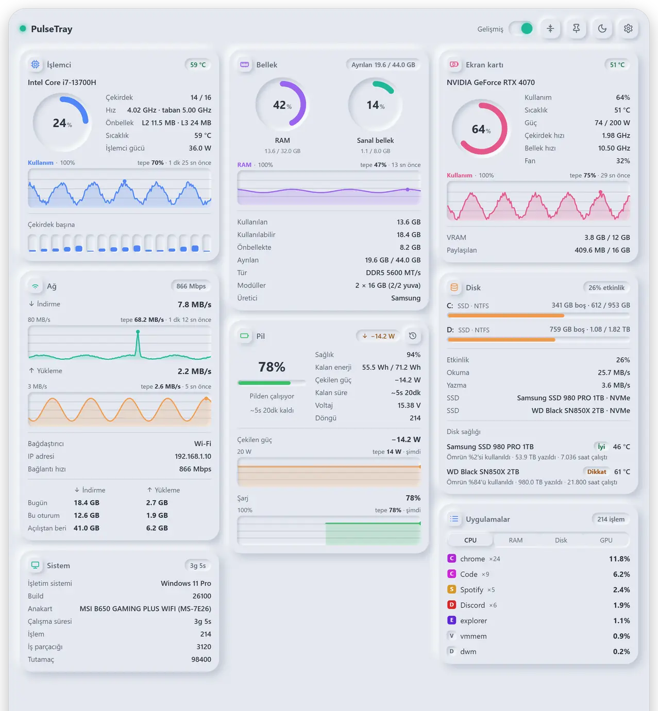
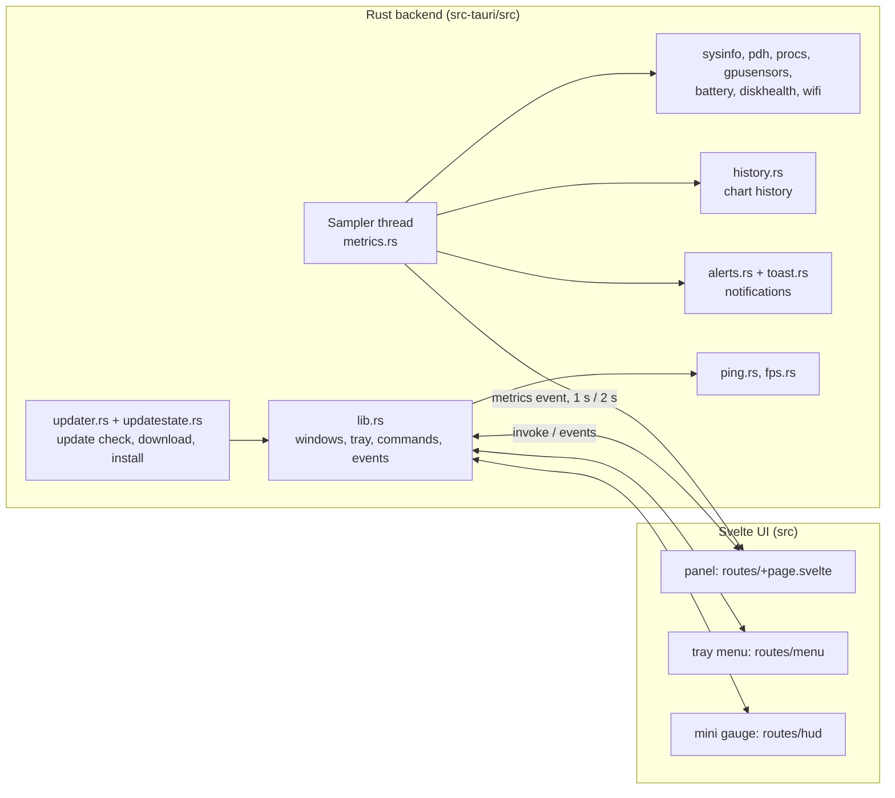

<h1 align="center">PulseTray</h1>

<p align="center"><strong>A light system monitor that waits in the Windows notification area: click the icon, see your PC.</strong></p>

<p align="center"><b>English</b> | <a href="README.tr.md">Türkçe</a></p>

<p align="center">
  
  
  
  
  
</p>

<p align="center">
  <picture>
    <source media="(prefers-color-scheme: dark)" srcset="docs/images/pulsetray-dark.webp">
    
  </picture>
  <br>
  <sub>The panel in Advanced mode, with sample data and the Turkish interface (the app also speaks English).</sub>
</p>

PulseTray sits in the tray and costs next to nothing until you open it. A click on the icon (or **Ctrl+Alt+P**) opens a small panel with CPU, memory, GPU, network, disk, battery, latency, Wi-Fi, top apps and system details. It is a Tauri 2 app: a Rust backend measures, a Svelte 5 interface draws.

## Highlights

- **Ten tiles** (CPU, Memory, GPU, Network, Disk, Battery, Latency, Wi-Fi, Top Apps, System) in a Classic view and a more detailed Advanced view. Tiles that make no sense on your PC (a battery on a desktop, Wi-Fi without an adapter, a GPU without counters) do not appear, and Settings says why.
- **No administrator rights for the sensors.** Everything comes from interfaces Windows already offers (performance counters, the graphics kernel's performance interface, NVIDIA's NVML when the driver ships it, the WLAN API, battery and storage IOCTLs). The two exceptions are in [Sensors](#sensors-what-is-there-what-is-not).
- **Charts that also cover the time the panel was closed**, up to one hour, plus "who caused that peak?" (hover a CPU, memory, disk or GPU chart).
- **Mini Gauge:** a small always-on-top card on the desktop with FPS, CPU, GPU, RAM, network and disk. It never takes focus and hides during full-screen apps.
- **Opt-in alerts** as Windows notifications (disk nearly full, memory near its limit, high temperature, worsening drive health, an app hogging the CPU).
- **Tray extras:** a live CPU, GPU or RAM percentage as the tray icon, a tooltip with live values, and a themed right-click menu.
- **Per-tile customization:** hide, reorder, and choose rows, header badge and chart for each tile in Advanced view.
- **Two visual styles** (Neumorphic and Glassmorphic), light, dark or system theme, English and Turkish.
- **Self-updating:** daily check, download with progress, SHA-256 verification, quiet restart, automatic roll-back when a new version keeps failing at start-up.

## What it shows

| Tile | Classic view | Advanced view adds |
|---|---|---|
| CPU | load, clock | model, cores and threads, base clock, cache, temperature, per-core bars (hover for load and clock) |
| Memory | RAM and virtual memory (page file) rings | available, cached, committed memory (header badge), memory type, speed, modules, maker |
| GPU | load, memory | core and memory clock, temperature, fan, power (NVIDIA), one tab per GPU |
| Network | speed, today's total | adapter, IP address, link speed, today / session / since-boot table |
| Disk | space used (red above 90 %), read and write speed | active time, all drives, physical disk models, drive health |
| Battery | charge, power, time to full or empty | health, remaining energy (Wh), voltage, cycle count, power and charge charts; the clock icon in the header opens the battery history |
| Latency | a 3-minute or unlimited test | per-target average, minimum, maximum, jitter, loss, charts, continuous measurement |
| Wi-Fi | signal, link speed (when not connected: state and nearby networks) | network name, standard (Wi-Fi 5, 6, 7); when not connected: adapter, number of networks, strongest network |
| Top Apps | top apps by CPU, RAM, disk or GPU, with their icons | process count, up to 10 apps when the column has room; right-click: open file location, end task (asks once more) |
| System | uptime, operating system | motherboard, build number, thread and handle counts |

### More to know

- **Battery history** comes from Windows' own battery report (`powercfg /batteryreport /xml`, no administrator needed): how the battery's health developed since the first record, screen-on time on battery and on AC for up to the last 14 days (Windows keeps older days per week, so there can be fewer days; the header says how many), and the charge level of the last days.
- **Customize** (Settings > Modules, slider icon): in Advanced view, choose each tile's rows, header badge and chart. Top Apps also has a start tab, list length, tabs, icons and the ×n counter; Latency has chart, summary values and the IP row. Options your PC cannot measure are greyed out with the reason underneath; a tile that was set to one falls back to the first measurable option.
- **Pin the panel:** it stays open, can be dragged and resized, and remembers its size separately for Classic and Advanced.
- **Tiles** can be hidden and reordered, separately for each view. On a fresh start Latency and Wi-Fi are off and System is on. PulseTray registers itself to start at login on the first run; Settings > General > **Start at Login** turns that off, and it is not switched on again afterwards.
- **Charts:** Advanced view looks back 3 minutes, 15 minutes or 1 hour; history is recorded while the panel is closed. The axis label says what a chart shows; hovering shows the value at that moment.
- **Top-app history:** "Who caused that peak?" lists the top 3 apps at that moment for the CPU, memory, disk and GPU charts. The app list is sampled every 6 seconds while the panel is closed and kept for the last hour. GPU history only exists for moments when the GPU counters were running (GPU tile, tray icon or gauge showing GPU).
- **Alerts** (Settings > Alerts, everything off until you switch it on): drive nearly full (85 / 90 / 95 %), committed memory above 90 % of its limit for 30 s, GPU above 80 / 85 / 90 °C for 30 s (drives at their own warning temperature), drive health got worse (reported once, not again after a restart), one app using 30 / 50 / 80 % of the CPU for 5 minutes. They are held back while a game or full-screen video is in front, and clicking a notification opens the panel. An enabled alert keeps reading what it needs while the panel is closed.
- **Drive health:** for NVMe drives, health state (Good / Caution / Bad), temperature, wear, data written and power-on hours without administrator rights; for SATA drives, temperature where the drive supports it. The Disk tile's header can show the hottest drive.
- **Tray icon** (Settings > Appearance): the logo, or the live CPU, GPU or RAM percentage. **Tray menu** (right-click): **Update · vX** at the top when an update is waiting, **Show** (or **Hide** while a pinned panel is open), **Settings**, **Theme** (System, Dark, Light; it changes the panel, the gauge and the menu at once), **Mini Gauge** (checked when on), **Exit**. A single click on the icon toggles the panel.
- **Styles** (Settings > Appearance): *Neumorphic* (default, soft embossed surfaces) or *Glassmorphic* (frosted panels over a gentle gradient). The window is transparent, so the blur only blurs what the page itself draws, not your desktop; therefore the glass background is a static gradient inside the page, and the gauge and the tray menu use an opaque glass-look fill. Unknown stored values fall back to Neumorphic.
- **Language:** Auto (follows the system language), TR · Türkçe or US · English.

### Mini Gauge and FPS

A small card that stays on top of the desktop. Drag it anywhere (the position is remembered); it does not take focus and does not show in Alt+Tab; it can let clicks through (Settings > Mini Gauge > Click-Through) and hides while a full-screen game or video is in front (switchable). Opacity runs from 85 to 100 %: with less, content moving behind the card (chat, video) shone through and looked like flicker. FPS is shown large on top: 60 and above green, 30-59 orange, below 30 red. Theme and language follow the panel at once. Switch it on in Settings > Mini Gauge or from the tray menu.

**FPS** (selected in the gauge settings) counts the frames of the app in front. Nothing is injected into the game: PulseTray listens to the ETW events Windows writes for every presented frame (the same events PresentMon and the Xbox Game Bar use), DXGI for DirectX 10/11/12 and D3D9 for DirectX 9. For Vulkan and OpenGL the graphics kernel's present history is listened to only for a few seconds when the app in front does not use DirectX, because that source produces tens of thousands of events per second while a game runs. Measuring runs only while FPS is selected in the gauge. It needs an administrator or an account in the "Performance Log Users" group. Browsers do not show up, because they draw frames in a separate process.

### Latency test

Nothing is pinged in the background. The test runs only when you start it (3 minutes or unlimited), or in Advanced view while **Continuous** is on and the panel is open (then there is no timed test and the card says "Measuring continuously"). When a full-screen app such as a game or a video is in front, measuring stops by itself. Targets (default: gateway, Cloudflare 1.1.1.1, Google 8.8.8.8, up to 6) are edited in Settings; while the Latency module is off that section is hidden. It uses Windows' `IcmpSendEcho`, so no administrator is needed.

## Sensors: what is there, what is not

All of it works without administrator rights and with what Windows itself provides, with one exception: FPS (see above).

- **CPU load** is the share of time the cores were busy (total, per core and for apps, the same measure). Task Manager multiplies it by current-over-base clock, so in turbo it can show 100 % while some cores idle; PulseTray does not.
- **CPU temperature** is the hottest ACPI thermal zone. On most machines that is the processor, but the motherboard decides, so treat it as approximate. On most AMD Ryzen desktops Windows exposes none at all.
- **CPU power** exists only on Intel (Windows "Energy Meter"). On AMD Ryzen there are no watts: reading them needs a kernel driver, which PulseTray deliberately does not install.
- **GPU load and temperature** come from Windows' performance interface (like Task Manager).
- **GPU power and fan** exist only on NVIDIA. A sleeping GPU is not woken up just to read it.
- **Per-app network usage** needs administrator rights, so it is not in the Top Apps tile.
- Top Apps is a quick ranking, not an accounting tool; values can differ from Task Manager. "End task" leaves PulseTray's own processes and Windows' critical processes alone.

## Install

### Official build

Installer and portable executable: **https://macik.com.tr**

Windows 10 or 11 and the WebView2 runtime are required. The installer sets PulseTray up per user (no administrator rights) and fetches the WebView2 runtime if it is missing.

### From source

Prerequisites:

- Windows 10 or 11, the [Tauri prerequisites for Windows](https://v2.tauri.app/start/prerequisites/#windows) (Microsoft C++ Build Tools, WebView2)
- Rust, stable (the crate uses the 2024 edition, so 1.85 or newer)
- Node.js 22.18 or newer (the tests rely on Node's built-in TypeScript type stripping, which is on by default from 22.18)

```powershell
git clone https://github.com/Aseloth99/pulsetray.git
cd pulsetray
npm install
npm run tauri dev
```

`npm run tauri dev` starts the Vite dev server and the app.

> **Good to know for builds you run yourself.**
> - On its first run with fresh settings, PulseTray registers itself for **Start at Login**: an entry named `PulseTray` under `HKCU\Software\Microsoft\Windows\CurrentVersion\Run`, pointing at the running exe. That also holds for `npm run tauri dev` (the web view's settings storage differs between dev and release builds, so a dev run counts as a first run), and it takes over the entry of an installed official copy. For experiments, set another `identifier` in `src-tauri/tauri.conf.json`: the entry is then named `PulseTray (<identifier>)` and the settings storage is separate too. Settings > General > Start at Login switches it off.
> - A release build you compile uses the same update channel as the official build, and **Install Updates Automatically** is on by default: once the server offers a newer version than yours, it replaces your own exe. Switch both update options off in Settings > General if you do not want that. A development build never checks for updates and never replaces itself.

## Usage

| Do this | To get |
|---|---|
| Click the tray icon, or press **Ctrl+Alt+P** | open or close the panel (the shortcut can be switched off in Settings > General; Settings tells you if another app already owns the combination) |
| Right-click the tray icon | the tray menu |
| **Esc** | go back from Settings / battery history / the update screen, then close the panel (unless pinned) |
| Header: **Advanced** switch | Classic or Advanced view |
| Header: fit icon | resize the panel to what its tiles need (appears when the panel is not that size) |
| Header: pin icon | keep the panel open; drag and resize it |
| Header: sun / moon icon | quick light / dark switch (the "System" choice stays in Settings) |
| Header: gear icon | Settings |
| Hover a chart | value at that moment, and the top apps at a peak |
| Right-click an app in Top Apps | open file location, end task |

Settings sections: **Appearance** (theme, style, language, tray icon), **Modules** (show, hide and reorder tiles, Customize; Latency targets when the module is on), **Mini Gauge**, **Alerts**, **General** (shortcut, Start at Login, update options, version, **Check Now**, link to macik.com.tr, Exit).

## Updates and announcements

Once a day PulseTray asks `https://macik.com.tr/api/updates/check` (with the app name and the installed version) whether a newer version exists. The check only asks; it downloads nothing. It can be switched off in Settings > General > **Check for Updates Automatically**; the manual **Check Now** always works.

- When a newer version exists, the panel and the tray menu show **Update · vX**. It opens the update screen (version, download size, release notes as plain text). **Update** downloads the package (progress bar, **Cancel**), verifies it, restarts quietly into the new version and shows an "updated" notification. Errors appear on the same screen with **Retry**; the old version keeps running.
- **Install Updates Automatically** (needs the automatic check; on by default) does the download and install in the background, when the panel is closed and no latency test is running. Without a server-provided SHA-256 checksum nothing is installed automatically; the update is only offered.
- The download must come from `macik.com.tr` over https (redirects are checked hop by hop) and match the server's SHA-256; the file type is recognized by its content (an `.exe`, or a `.zip` containing `pulsetray.exe`).
- If a new version dies at start-up twice, the previous version is restored automatically and that version is not offered again.
- The server can send a one-line **announcement**. It appears above the panel and is dismissed with the cross. The link in an announcement is only opened if it is an https address on macik.com.tr.

## Architecture



The sampler thread measures every second while the panel (or the gauge) is visible and every 2 seconds otherwise, keeps the chart history on the Rust side, and pushes each sample to the windows as an event. The panel, the right-click menu and the gauge are three web views with their own pages; the main window owns the settings and hands the gauge and the tray menu what they need through the backend and the saved settings. The web views are created only after the app state exists (`"create": false` in `tauri.conf.json`), and a hidden panel's web view is asked to give memory back after a minute.

```
pulsetray/
├── package.json  package-lock.json  svelte.config.js  vite.config.js  tsconfig.json
├── assets/icon.svg                 source of the app icon
├── scripts/collect-release.ps1     collects the build output into release/ and writes SHA256SUMS.txt
├── src/                            SvelteKit UI (static adapter, single-page mode)
│   ├── routes/
│   │   ├── +page.svelte            panel: header, tiles, Settings, battery history, update screen
│   │   ├── menu/+page.svelte       right-click tray menu (a small window of its own)
│   │   └── hud/+page.svelte        desktop mini gauge (a window of its own)
│   ├── lib/
│   │   ├── tiles/*.svelte          one component per tile
│   │   ├── metrics.svelte.ts       store: live metrics, chart history, latency state
│   │   ├── settings.svelte.ts      persisted settings (theme, style, tiles, details, gauge, alerts)
│   │   ├── prefs.ts  tiledetail.ts  traymenu.ts  format.ts  notes.ts   pure logic (unit-tested)
│   │   ├── i18n.ts  tr.ts          English and Turkish strings
│   │   └── update.svelte.ts  caps.svelte.ts  ...
│   └── app.css  glass.css          the two visual styles
├── tests/                          node --test: settings rules, strings, tray menu
└── src-tauri/                      Rust backend and Tauri configuration
    ├── Cargo.toml  Cargo.lock  tauri.conf.json  capabilities/default.json  icons/
    └── src/
```

| Module (`src-tauri/src`) | Job |
|---|---|
| `lib.rs`, `main.rs` | application state, windows, tray, global shortcut, all Tauri commands and events |
| `metrics.rs` | the sampler: CPU, memory, disks, network, battery, GPU, Wi-Fi, processes into one `Metrics` snapshot |
| `pdh.rs`, `procs.rs` | performance counters (GPU, disk activity) and per-process CPU, memory, disk from one system call |
| `gpusensors.rs`, `battery.rs`, `diskhealth.rs`, `wifi.rs` | GPU clocks, temperature, fan, power; battery capacity and power; drive health; Wi-Fi |
| `hardware.rs` | static hardware facts, read once on a separate thread |
| `history.rs` | chart history kept on the Rust side, also while the panel is closed |
| `ping.rs`, `pingstate.rs` | ICMP latency probes and the test state machine (pure logic, unit-tested) |
| `fps.rs`, `hud.rs`, `fullscreen.rs` | FPS from ETW, the mini gauge window, full-screen detection |
| `alerts.rs`, `toast.rs` | alert rules and Windows notifications |
| `apps.rs`, `trayicon.rs`, `batteryreport.rs`, `usage.rs`, `autostart.rs` | app icons and actions, the live tray icon, battery history from `powercfg`, per-day network totals, start at login |
| `updater.rs`, `updatestate.rs`, `remote_notice.rs` | update check, download, SHA-256 check, install and roll-back; the update state machine; the announcement line |

## Build

```powershell
npm install
npm run tauri build
powershell -NoProfile -ExecutionPolicy Bypass -File scripts\collect-release.ps1
```

`tauri build` produces the NSIS installer (`src-tauri\target\release\bundle\nsis\`) and `pulsetray.exe`. `collect-release.ps1` gathers them into `release\` as `PulseTray-Setup-<version>.exe`, `PulseTray-<version>-portable.exe`, `PulseTray-<version>-update.zip` (the self-updater extracts `pulsetray.exe` from this zip) and `SHA256SUMS.txt`.

To keep your user name out of the compiled executable (cargo registry paths would otherwise end up in it), set path remapping before building (`RUSTFLAGS` is split at spaces, so for paths with spaces use `CARGO_ENCODED_RUSTFLAGS` instead):

```powershell
$env:RUSTFLAGS = "--remap-path-prefix=$env:USERPROFILE\.cargo=C:\cargo --remap-path-prefix=$env:USERPROFILE\.rustup=C:\rustup --remap-path-prefix=$PWD=."
npm run tauri build
```

## Tests

```powershell
npm test                 # node --test: settings rules, strings, tray menu
npm run check            # svelte-check (types in the Svelte and TypeScript code)
cd src-tauri
cargo test               # Rust unit tests
```

A few Rust tests are marked `#[ignore]` because they read the real hardware, show notifications or need a network; run them on purpose with `cargo test -- --ignored --nocapture`.

## Platform notes

PulseTray is a Windows application. Some modules contain branches for macOS and Linux (start at login, notifications) that are covered by unit tests of their text output but have never been run on those systems; treat them as experimental. The project is not expected to build on other platforms as it stands.

## Dependencies and licenses

The source code is MIT-licensed (see [LICENSE](LICENSE)). The dependencies keep their own licenses. According to `cargo metadata` the Rust crates in the Windows build are under permissive licenses: mostly MIT and/or Apache-2.0, plus BSD-3-Clause, ISC, Zlib, Unicode-3.0, CDLA-Permissive-2.0 (webpki-roots) and five MPL-2.0 crates (`cssparser`, `cssparser-macros`, `selectors`, `dtoa-short`, `option-ext`, pulled in by Tauri); no GPL or LGPL crate was found. The interface uses Svelte and `@tauri-apps/api` (MIT, Apache-2.0 or MIT). The build tooling includes `lightningcss` (MPL-2.0), which is not part of the shipped app. The Microsoft WebView2 runtime is a separate redistributable under Microsoft's own terms. This is an overview, not a legal audit: check `Cargo.lock` and `package-lock.json` for the full list before you redistribute binaries.

## License

[MIT](LICENSE) © 2026 Mustafa Açık. The official site is https://macik.com.tr.
