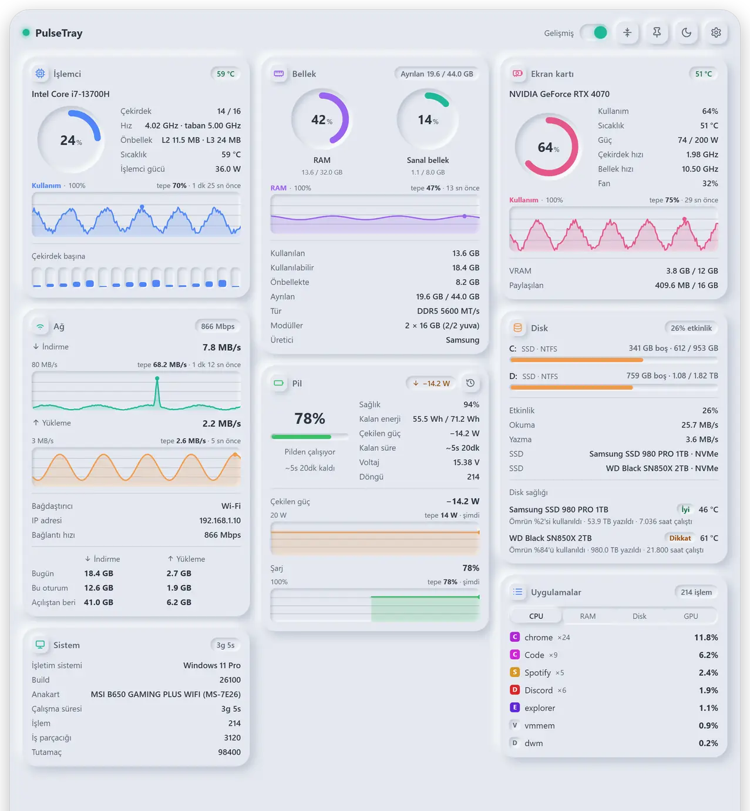
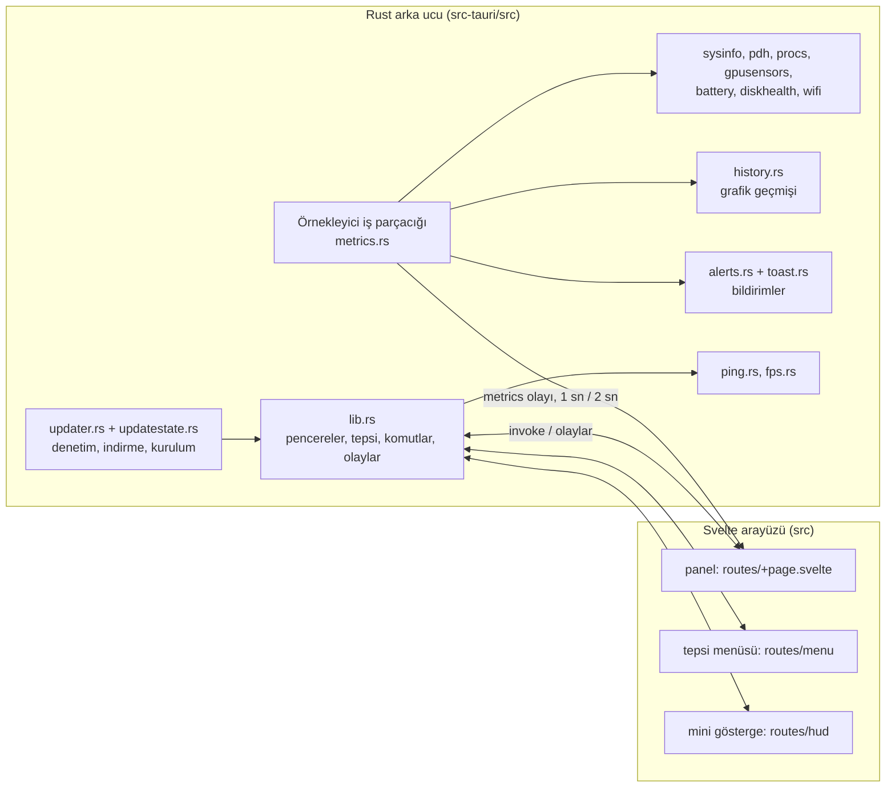

<h1 align="center">PulseTray</h1>

<p align="center"><strong>Windows bildirim alanında bekleyen hafif bir sistem izleyici: simgeye tıklayın, bilgisayarınızı görün.</strong></p>

<p align="center"><a href="README.md">English</a> | <b>Türkçe</b></p>

<p align="center">
  
  
  
  
  
</p>

<p align="center">
  <picture>
    <source media="(prefers-color-scheme: dark)" srcset="docs/images/pulsetray-dark.webp">
    
  </picture>
  <br>
  <sub>Panelin Gelişmiş modu, örnek verilerle ve Türkçe arayüzle (uygulama İngilizce de konuşur).</sub>
</p>

PulseTray tepside durur ve siz açana kadar neredeyse hiçbir şeye mal olmaz. Simgeye tıklayınca (ya da **Ctrl+Alt+P** ile) küçük bir panel açılır: işlemci, bellek, ekran kartı, ağ, disk, pil, gecikme, Wi-Fi, en çok kaynak kullanan uygulamalar ve sistem bilgileri. Bir Tauri 2 uygulamasıdır: ölçümü Rust arka ucu yapar, görünümü Svelte 5 arayüzü çizer.

## Öne çıkanlar

- **On kutucuk** (İşlemci, Bellek, Ekran kartı, Ağ, Disk, Pil, Gecikme, Wi-Fi, Uygulamalar, Sistem), Klasik görünümde ve daha ayrıntılı Gelişmiş görünümde. Bilgisayarınızda anlamı olmayan kutucuklar (masaüstünde pil, bağdaştırıcısı olmayan makinede Wi-Fi, sayacı olmayan ekran kartı) hiç görünmez; Ayarlar nedenini yazar.
- **Sensörler için yönetici hakkı gerekmez.** Her şey Windows'un zaten sunduğu arayüzlerden gelir (performans sayaçları, grafik çekirdeğinin performans arayüzü, sürücüsü getiriyorsa NVIDIA'nın NVML'i, WLAN API'si, pil ve depolama IOCTL'leri). İki istisna [Sensörler](#sensörler-neler-var-neler-yok) bölümünde.
- **Panel kapalıyken de kaydedilen grafikler**, 1 saate kadar; ayrıca "Bu tepe kimdi?" (işlemci, bellek, disk ya da ekran kartı grafiğinin üzerine gelin).
- **Mini Gösterge:** masaüstünde her zaman üstte duran küçük bir kart (FPS, CPU, GPU, RAM, ağ, disk). Odak çalmaz, tam ekran uygulamalarda gizlenir.
- **İsteğe bağlı uyarılar**, Windows bildirimi olarak (disk dolmak üzere, bellek sınıra yaklaştı, yüksek sıcaklık, disk sağlığı kötüleşti, bir uygulama işlemciyi yiyor).
- **Tepsi ekstraları:** tepsi simgesi olarak canlı işlemci, ekran kartı ya da RAM yüzdesi, canlı değerlerle ipucu ve temaya uyan sağ tık menüsü.
- **Kutucuk başına özelleştirme:** Gelişmiş görünümde her kutucuk için gizleme, sıralama, satırları, başlık rozetini ve grafiği seçme.
- **İki görsel tasarım** (Neumorfik ve Cam), açık, koyu ya da sistem teması; Türkçe ve İngilizce.
- **Kendini günceller:** günlük denetim, ilerlemeli indirme, SHA-256 doğrulaması, sessiz yeniden başlatma; yeni sürüm açılışta sürekli düşerse otomatik geri dönüş.

## Neler gösterir

| Kutucuk | Klasik görünüm | Gelişmiş modda ek olarak |
|---|---|---|
| İşlemci | yük, hız | model, çekirdek ve iş parçacığı sayısı, taban hız, önbellek, sıcaklık, çekirdek başına çubuklar (üzerine gelince yük ve hız) |
| Bellek | RAM ve sanal bellek (sayfa dosyası) halkaları | kullanılabilir, önbellek, ayrılan bellek (başlık rozeti), bellek türü, hızı, modülleri, üreticisi |
| Ekran kartı | yük, bellek | çekirdek ve bellek hızı, sıcaklık, fan, güç (NVIDIA), her ekran kartı için ayrı sekme |
| Ağ | hız, bugünkü toplam | bağdaştırıcı, IP, bağlantı hızı, bugün / oturum / açılıştan beri tablosu |
| Disk | doluluk (%90 üstü kırmızı), okuma ve yazma hızı | etkinlik süresi, tüm sürücüler, fiziksel disk modelleri, disk sağlığı |
| Pil | şarj, güç, dolma ya da bitme süresi | sağlık, kalan enerji (Wh), voltaj, döngü sayısı, güç ve şarj grafikleri; başlıktaki saat simgesi pil geçmişini açar |
| Gecikme | 3 dakikalık ya da süresiz test | hedef başına ortalama, en az, en çok, sapma, kayıp, grafikler, sürekli ölçüm |
| Wi-Fi | sinyal, hız (bağlı değilken: durum ve çevredeki ağlar) | ağ adı, standart (Wi-Fi 5, 6, 7); bağlı değilken bağdaştırıcı, ağ sayısı, en güçlü ağ |
| Uygulamalar | işlemci, RAM, disk ya da ekran kartına göre en çok kullanan uygulamalar, simgeleriyle | işlem sayısı, sütunda yer varsa 10 uygulamaya kadar; sağ tık: dosya konumunu aç, görevi sonlandır (bir kez daha sorar) |
| Sistem | açık kalma süresi, işletim sistemi | anakart, yapı numarası, iş parçacığı ve tutamaç sayısı |

### Bilmeniz gerekenler

- **Pil geçmişi**, Windows'un kendi pil raporundan gelir (`powercfg /batteryreport /xml`, yönetici gerekmez): sağlığın ilk kayıttan bugüne seyri, son 14 güne kadar her günün ekran açık süresi (pilde ve prizde; Windows eski günleri haftalık tuttuğu için bazen daha az gün olur, başlık kaç gün olduğunu yazar) ve son günlerin şarj seviyesi.
- **Özelleştir** (Ayarlar > Modüller, kaydırıcı simgesi): Gelişmiş görünümde her kutucuğun satırlarını, başlık rozetini ve grafiğini seçersiniz. Uygulamalar'da ayrıca açılış sekmesi, liste uzunluğu, sekmeler, simgeler ve ×n sayacı; Gecikme'de grafik, özet değerler ve IP satırı vardır. Bilgisayarınızın ölçemediği seçenekler soluktur ve seçilemez, altında nedeni yazar; daha önce seçilmişse kutucuk ilk ölçülebilen seçeneğe döner.
- **Paneli iğneleyin:** açık kalır, sürüklenir, yeniden boyutlanır; boyutunu Klasik ve Gelişmiş için ayrı hatırlar.
- **Kutucukları** gizleyebilir ve sıralayabilirsiniz; Klasik ve Gelişmiş görünüm için ayrı ayrı. İlk açılışta Gecikme ve Wi-Fi kapalı, Sistem açık gelir. PulseTray ilk çalışmada açılışta başlayacak şekilde kurulur; Ayarlar > Genel > **Açılışta Başlat** bunu kapatır ve sonradan kendiliğinden açılmaz.
- **Grafikler:** Gelişmiş modda 3 dakika, 15 dakika ya da 1 saat geriye gider; panel kapalıyken de kaydedilir. Grafiğin ne gösterdiği ölçeğin yanında yazar; üzerine gelince o anki değer çıkar.
- **Bu tepe kimdi?** İşlemci, bellek, disk ve ekran kartı grafiklerinin üzerine gelince o anda en çok kullanan 3 uygulama görünür. Uygulama listesi panel kapalıyken de 6 saniyede bir ölçülüp son 1 saat saklanır. Ekran kartı için yalnızca ekran kartı sayaçlarının çalıştığı anlar bilinir (ekran kartı kutucuğu, tepsi simgesi ya da mini göstergede GPU).
- **Uyarılar** (Ayarlar > Uyarılar, hepsi siz açana kadar kapalı): disk dolmak üzere (%85 / 90 / 95), ayrılan bellek sınırının %90'ını 30 sn geçti, ekran kartı 30 sn boyunca 80 / 85 / 90 °C'yi geçti (diskler kendi uyarı sıcaklığında), disk sağlığı kötüleşti (aynı durum bir kez; yeniden başlatınca tekrar etmez), bir uygulama 5 dakika işlemcinin %30 / 50 / 80'ini kullandı. Oyun ya da tam ekran video sırasında bekletilir; bildirime tıklamak paneli açar. Açık bir uyarı, gerektirdiği değerleri panel kapalıyken de okur.
- **Disk sağlığı:** NVMe disklerde yönetici hakkı gerekmeden sağlık durumu (İyi / Dikkat / Kötü), sıcaklık, ömür kullanımı, yazılan veri ve çalışma saati; SATA disklerde destekleniyorsa sıcaklık. Disk kutucuğunun başlığında en sıcak disk de gösterilebilir.
- **Tepsi simgesi** (Ayarlar > Görünüm): logo ya da canlı işlemci, ekran kartı veya RAM yüzdesi. **Tepsi menüsü** (sağ tık): güncelleme varsa en üstte **Güncelle · vX**; **Göster** (panel iğneli ve açıksa **Gizle**), **Ayarlar**, **Tema** (Sistem, Koyu, Açık; panelin, mini göstergenin ve menünün temasını anında değiştirir), **Mini Gösterge** (açıksa işaretli), **Çıkış**. Simgeye tek tıklamak paneli açar ya da kapatır.
- **Tasarım** (Ayarlar > Görünüm): *Neumorfik* (varsayılan, yumuşak kabartmalı yüzeyler) ya da *Cam (Glassmorphic)*: hafif bir gradyan üstünde buzlu cam paneller. Pencere şeffaf olduğundan bulanıklık yalnızca sayfanın kendi çizdiği arka planı bulanıklaştırır, masaüstünü değil; bu yüzden panelin cam arka planı sayfanın içinde statik bir gradyandır, mini gösterge ve tepsi menüsü ise opak, cam görünümlü bir dolgu kullanır. Tanınmayan kayıtlı değerler Neumorfik açılır.
- **Dil:** Otomatik (sistem dilini izler), TR · Türkçe ya da US · English.

### Mini Gösterge ve FPS

Masaüstünde her zaman üstte duran küçük bir kart. İstediğiniz yere sürüklenir (yeri hatırlanır); odak çalmaz ve Alt+Tab'da görünmez; istenirse tıklamaları geçirir (Ayarlar > Mini Gösterge > **Tıklamaları Geçir (Kilitli)**) ve tam ekran oyun ya da videoda gizlenir (kapatılabilir). Opaklık %85–100 arasındadır: daha saydamken arkada kayan içerik (sohbet, video) kartın içinden görünüp titreme gibi duruyordu. FPS en üstte iri yazılır: 60 ve üstü yeşil, 30–59 turuncu, 30 altı kırmızı. Panelde tema ya da dil değişince gösterge de anında değişir. Ayarlar > Mini Gösterge'den ya da tepsi menüsünden açılır.

**FPS** (gösterge ayarlarından seçilir), öndeki uygulamanın karelerini sayar. Oyuna hiçbir şey eklenmez: PulseTray, Windows'un her sunulan karede yazdığı ETW olaylarını dinler (PresentMon ve Xbox Game Bar'ın da kullandığı olaylar); DirectX 10/11/12 için DXGI, DirectX 9 için D3D9. Vulkan ve OpenGL için grafik çekirdeğinin sunum geçmişi yalnızca öndeki uygulama DirectX kullanmıyorsa birkaç saniyeliğine dinlenir, çünkü o kaynak oyun çalışırken saniyede on binlerce olay üretir. Ölçüm yalnızca göstergede FPS seçiliyken çalışır. Yönetici ya da "Performance Log Users" grubunda bir hesap gerekir. Tarayıcılar kareleri ayrı bir işlemde çizdiği için onlarda görünmez.

### Gecikme testi

Arka planda kendiliğinden ping atılmaz. Test yalnızca siz başlatınca (3 dakika ya da süresiz) ya da Gelişmiş modda **Sürekli ölçüm** açıkken ve panel açıkken çalışır (o zaman zamanlı test yoktur, kart "Sürekli ölçülüyor" der). Oyun, video gibi tam ekran bir uygulama öndeyse ölçüm kendiliğinden durur. Hedefler (varsayılan: ağ geçidi, Cloudflare 1.1.1.1, Google 8.8.8.8; en fazla 6) Ayarlar'dan değişir; Gecikme modülü kapalıyken bu bölüm görünmez. Windows'un `IcmpSendEcho` işlevini kullanır, yönetici gerekmez.

## Sensörler: neler var, neler yok

Hepsi yönetici hakkı olmadan, yalnızca Windows'un kendi sunduklarıyla çalışır; tek istisna FPS'tir (yukarıya bakın).

- **CPU yükü:** Çekirdeklerin meşgul olduğu sürenin payı (toplam, çekirdek başına ve uygulamalar için aynı ölçü). Görev Yöneticisi bunu bir de anlık hız / taban hız oranıyla çarpar: turboda bazı çekirdekler boştayken bile %100 gösterebilir, PulseTray göstermez.
- **CPU sıcaklığı:** En sıcak ACPI ısı bölgesi; çoğu makinede işlemcidir ama anakart belirler, yaklaşık değer sayın. AMD Ryzen masaüstlerinin çoğunda Windows bunu hiç vermez.
- **CPU gücü:** Yalnızca Intel (Windows "Energy Meter"). AMD Ryzen'de watt yoktur; okumak için çekirdek sürücüsü gerekir, PulseTray bunu bilerek kurmaz.
- **GPU hızı ve sıcaklığı:** Windows'un performans arayüzünden (Görev Yöneticisi'ndeki gibi).
- **GPU gücü ve fan:** Yalnızca NVIDIA. Uyuyan ekran kartı sırf okumak için uyandırılmaz.
- **Uygulama başına ağ kullanımı** yönetici hakkı ister; bu yüzden Uygulamalar kutucuğunda yoktur.
- Uygulamalar kutucuğu hızlı bir sıralamadır, muhasebe aracı değil; değerler Görev Yöneticisi'nden farklı çıkabilir. "Görevi sonlandır", PulseTray'in kendi işlemlerine ve Windows'un kritik işlemlerine dokunmaz.

## Kurulum

### Resmî sürüm

Kurulum dosyası ve taşınabilir çalıştırılabilir dosya: **https://macik.com.tr**

Windows 10 ya da 11 ve WebView2 çalışma zamanı gerekir. Kurulum dosyası PulseTray'i kullanıcı başına kurar (yönetici hakkı gerekmez); WebView2 yoksa onu da indirir.

### Kaynaktan

Gerekenler:

- Windows 10 ya da 11, [Windows için Tauri önkoşulları](https://v2.tauri.app/start/prerequisites/#windows) (Microsoft C++ Build Tools, WebView2)
- Rust, kararlı sürüm (kasa 2024 sürümünü kullanır, yani 1.85 ya da yenisi)
- Node.js 22.18 ya da yenisi (testler Node'un yerleşik TypeScript tür temizlemesine dayanır, 22.18'den itibaren varsayılan olarak açıktır)

```powershell
git clone https://github.com/Aseloth99/pulsetray.git
cd pulsetray
npm install
npm run tauri dev
```

`npm run tauri dev`, Vite geliştirme sunucusunu ve uygulamayı başlatır.

> **Kendi derlediğiniz sürümler için bilmeniz gerekenler.**
> - Ayarlar yeni olduğu ilk çalışmada PulseTray kendini **Açılışta Başlat** için kaydeder: `HKCU\Software\Microsoft\Windows\CurrentVersion\Run` altında, çalışan exe'yi gösteren `PulseTray` adlı bir değer. Bu `npm run tauri dev` için de geçerlidir (web görünümünün ayar deposu geliştirme ve yayın sürümlerinde ayrı olduğundan geliştirme çalışması da ilk çalışma sayılır) ve kurulu resmî kopyanın girdisini devralır. Denemeler için `src-tauri/tauri.conf.json` içinde başka bir `identifier` verin: girdi o zaman `PulseTray (<identifier>)` adını alır, ayar deposu da ayrı olur. Ayarlar > Genel > Açılışta Başlat bunu kapatır.
> - Derlediğiniz bir yayın sürümü resmî sürümle aynı güncelleme kanalını kullanır ve **Güncellemeleri Otomatik Kur** varsayılan olarak açıktır: sunucu sizinkinden yeni bir sürüm sunduğunda kendi exe'nizin yerine geçer. İstemiyorsanız Ayarlar > Genel'de iki güncelleme seçeneğini de kapatın. Geliştirme sürümü güncelleme denetlemez ve kendini değiştirmez.

## Kullanım

| Ne yaparsınız | Ne olur |
|---|---|
| Tepsi simgesine tıklayın ya da **Ctrl+Alt+P** | paneli açar veya kapatır (kısayol Ayarlar > Genel'den kapatılabilir; birleşimi başka bir uygulama kullanıyorsa Ayarlar söyler) |
| Tepsi simgesine sağ tıklayın | tepsi menüsü |
| **Esc** | Ayarlar / pil geçmişi / güncelleme ekranından geri döner, sonra paneli kapatır (iğneli değilse) |
| Başlık: **Gelişmiş** anahtarı | Klasik ya da Gelişmiş görünüm |
| Başlık: sığdırma simgesi (**İçeriğe Göre Sığdır**) | paneli kutucukların istediği boyuta getirir (panel o boyutta değilken görünür) |
| Başlık: iğne simgesi (**Üstte Tut**) | paneli açık tutar; sürüklenir ve yeniden boyutlanır |
| Başlık: güneş / ay simgesi | hızlı açık / koyu geçişi (Sistem seçimi Ayarlar'da kalır) |
| Başlık: dişli simgesi | Ayarlar |
| Grafiğin üzerine gelin | o anki değer ve tepede en çok kullanan uygulamalar |
| Uygulamalar'da bir uygulamaya sağ tıklayın | dosya konumunu aç, görevi sonlandır |

Ayarlar bölümleri: **Görünüm** (tema, tasarım, dil, tepsi simgesi), **Modüller** (kutucukları göster, gizle, sırala, Özelleştir; modül açıkken Gecikme Hedefleri), **Mini Gösterge**, **Uyarılar**, **Genel** (kısayol, Açılışta Başlat, güncelleme seçenekleri, sürüm, **Kontrol Et**, macik.com.tr bağlantısı, Çıkış).

## Güncelleme ve duyurular

Günde bir kez PulseTray, `https://macik.com.tr/api/updates/check` adresine (uygulama adı ve kurulu sürümle) yeni bir sürüm olup olmadığını sorar. Denetim yalnızca sorar; hiçbir şey indirmez. Ayarlar > Genel > **Güncellemeleri Otomatik Kontrol Et** ile kapatılabilir; elle **Kontrol Et** her zaman çalışır.

- Yeni sürüm varsa panelde ve tepsi menüsünde **Güncelle · vX** çıkar. Tıklayınca güncelleme ekranı açılır (sürüm, indirme boyutu, sürüm notları düz metin olarak). **Güncelle**'ye basınca paket indirilir (ilerleme çubuğu ve **İptal** ile), doğrulanır, uygulama sessizce yeni sürümle yeniden başlar ve "güncellendi" bildirimi gelir. Hata olursa aynı ekranda gösterilir ve **Tekrar Dene** çıkar; eski sürüm çalışmaya devam eder.
- **Güncellemeleri Otomatik Kur** (otomatik kontrol açıkken kullanılabilir, varsayılan açık) indirme ve kurulumu arka planda yapar; panel kapalıyken ve gecikme testi çalışmıyorken kurulur. Sunucu SHA-256 sağlama toplamı vermediyse otomatik kurulum yapılmaz, güncelleme yalnızca sunulur.
- İndirme, https üzerinden `macik.com.tr` adresinden gelmeli ve sunucunun SHA-256 değeriyle eşleşmelidir (yönlendirmeler adım adım denetlenir); dosya türü içeriğine göre tanınır: doğrudan `.exe` ya da içinde `pulsetray.exe` olan `.zip`.
- Yeni sürüm açılışta iki kez ölürse önceki sürüm otomatik geri gelir ve o sürüm bir daha sunulmaz.
- Sunucu tek satırlık bir **duyuru** gönderebilir. Panelin üstünde çıkar ve ✕ ile kapatılır. Duyurudaki bağlantı yalnızca macik.com.tr üzerindeki bir https adresiyse açılır.

## Mimari



Örnekleyici iş parçacığı panel (ya da gösterge) görünürken her saniye, değilken iki saniyede bir ölçer, grafik geçmişini Rust tarafında tutar ve her örneği pencerelere olay olarak yollar. Panel, sağ tık menüsü ve gösterge, kendi sayfaları olan üç web görünümüdür; ayarları ana pencere yönetir, gösterge ve tepsi menüsüne gerekenleri arka uç ve kayıtlı ayarlar üzerinden iletir. Web görünümleri uygulama durumu oluştuktan sonra yaratılır (`tauri.conf.json` içinde `"create": false`) ve gizli panelin web görünümünden bir dakika sonra belleği geri vermesi istenir.

```
pulsetray/
├── package.json  package-lock.json  svelte.config.js  vite.config.js  tsconfig.json
├── assets/icon.svg                 uygulama simgesinin kaynağı
├── scripts/collect-release.ps1     derleme çıktısını release/ klasörüne toplar, SHA256SUMS.txt yazar
├── src/                            SvelteKit arayüzü (static adapter, tek sayfa kipi)
│   ├── routes/
│   │   ├── +page.svelte            panel: başlık, kutucuklar, Ayarlar, pil geçmişi, güncelleme ekranı
│   │   ├── menu/+page.svelte       sağ tık tepsi menüsü (kendi küçük penceresi)
│   │   └── hud/+page.svelte        masaüstü mini göstergesi (kendi penceresi)
│   ├── lib/
│   │   ├── tiles/*.svelte          her kutucuk için bir bileşen
│   │   ├── metrics.svelte.ts       depo: canlı ölçümler, grafik geçmişi, gecikme durumu
│   │   ├── settings.svelte.ts      kalıcı ayarlar (tema, tasarım, kutucuklar, ayrıntılar, gösterge, uyarılar)
│   │   ├── prefs.ts  tiledetail.ts  traymenu.ts  format.ts  notes.ts   saf mantık (birim testli)
│   │   ├── i18n.ts  tr.ts          İngilizce ve Türkçe metinler
│   │   └── update.svelte.ts  caps.svelte.ts  ...
│   └── app.css  glass.css          iki görsel tasarım
├── tests/                          node --test: ayar kuralları, metinler, tepsi menüsü
└── src-tauri/                      Rust arka ucu ve Tauri yapılandırması
    ├── Cargo.toml  Cargo.lock  tauri.conf.json  capabilities/default.json  icons/
    └── src/
```

| Modül (`src-tauri/src`) | İşi |
|---|---|
| `lib.rs`, `main.rs` | uygulama durumu, pencereler, tepsi, genel kısayol, tüm Tauri komutları ve olayları |
| `metrics.rs` | örnekleyici: işlemci, bellek, diskler, ağ, pil, ekran kartı, Wi-Fi, işlemler tek bir `Metrics` görüntüsünde |
| `pdh.rs`, `procs.rs` | performans sayaçları (ekran kartı, disk etkinliği) ve tek sistem çağrısıyla işlem başına işlemci, bellek, disk |
| `gpusensors.rs`, `battery.rs`, `diskhealth.rs`, `wifi.rs` | ekran kartı hızları, sıcaklık, fan, güç; pil kapasitesi ve gücü; disk sağlığı; Wi-Fi |
| `hardware.rs` | statik donanım bilgileri, ayrı bir iş parçacığında bir kez okunur |
| `history.rs` | grafik geçmişi, Rust tarafında tutulur, panel kapalıyken de |
| `ping.rs`, `pingstate.rs` | ICMP gecikme ölçümü ve test durum makinesi (saf mantık, birim testli) |
| `fps.rs`, `hud.rs`, `fullscreen.rs` | ETW'den FPS, mini gösterge penceresi, tam ekran algılama |
| `alerts.rs`, `toast.rs` | uyarı kuralları ve Windows bildirimleri |
| `apps.rs`, `trayicon.rs`, `batteryreport.rs`, `usage.rs`, `autostart.rs` | uygulama simgeleri ve eylemleri, canlı tepsi simgesi, `powercfg`'den pil geçmişi, günlük ağ toplamları, açılışta başlatma |
| `updater.rs`, `updatestate.rs`, `remote_notice.rs` | güncelleme denetimi, indirme, SHA-256 doğrulaması, kurulum ve geri alma; güncelleme durum makinesi; duyuru satırı |

## Derleme

```powershell
npm install
npm run tauri build
powershell -NoProfile -ExecutionPolicy Bypass -File scripts\collect-release.ps1
```

`tauri build`, NSIS kurulum dosyasını (`src-tauri\target\release\bundle\nsis\`) ve `pulsetray.exe`'yi üretir. `collect-release.ps1` bunları `release\` klasörüne `PulseTray-Setup-<sürüm>.exe`, `PulseTray-<sürüm>-portable.exe`, `PulseTray-<sürüm>-update.zip` (kendi kendini güncelleyen kısım `pulsetray.exe`'yi bu zip'ten çıkarır) ve `SHA256SUMS.txt` olarak toplar.

Kullanıcı adınızın derlenen exe'ye girmemesi için (aksi halde cargo kayıt defteri yolları içine girer) derlemeden önce yol maskelemeyi ayarlayın (`RUSTFLAGS` boşluklardan bölünür; boşluklu yollarda onun yerine `CARGO_ENCODED_RUSTFLAGS` kullanın):

```powershell
$env:RUSTFLAGS = "--remap-path-prefix=$env:USERPROFILE\.cargo=C:\cargo --remap-path-prefix=$env:USERPROFILE\.rustup=C:\rustup --remap-path-prefix=$PWD=."
npm run tauri build
```

## Testler

```powershell
npm test                 # node --test: ayar kuralları, metinler, tepsi menüsü
npm run check            # svelte-check (Svelte ve TypeScript kodunun türleri)
cd src-tauri
cargo test               # Rust birim testleri
```

Birkaç Rust testi `#[ignore]` ile işaretlidir, çünkü gerçek donanımı okur, bildirim gösterir ya da ağ ister; bilerek çalıştırmak için `cargo test -- --ignored --nocapture`.

## Platform notları

PulseTray bir Windows uygulamasıdır. Bazı modüllerde macOS ve Linux için dallar (açılışta başlatma, bildirimler) vardır; bunların metin çıktıları birim testlidir ama o sistemlerde hiç çalıştırılmamıştır, deneysel sayın. Proje şu haliyle başka platformlarda derlenmeyi beklemez.

## Bağımlılıklar ve lisanslar

Kaynak kod MIT lisanslıdır ([LICENSE](LICENSE)). Bağımlılıklar kendi lisanslarını korur. `cargo metadata`ya göre Windows derlemesindeki Rust kasaları izin verici lisanslarla gelir: çoğu MIT ve/veya Apache-2.0; ayrıca BSD-3-Clause, ISC, Zlib, Unicode-3.0, CDLA-Permissive-2.0 (webpki-roots) ve beş MPL-2.0 kasası (`cssparser`, `cssparser-macros`, `selectors`, `dtoa-short`, `option-ext`; Tauri getirir); GPL ya da LGPL kasası bulunmadı. Arayüz Svelte ve `@tauri-apps/api` kullanır (MIT, Apache-2.0 ya da MIT). Derleme araçlarında `lightningcss` (MPL-2.0) vardır; uygulamanın içinde gönderilmez. Microsoft WebView2 çalışma zamanı, Microsoft'un kendi koşullarıyla ayrıca dağıtılan bir bileşendir. Bu bir özettir, hukuki denetim değil: ikili dosya dağıtmadan önce tam liste için `Cargo.lock` ve `package-lock.json` dosyalarına bakın.

## Lisans

[MIT](LICENSE) © 2026 Mustafa Açık. Resmî site: https://macik.com.tr.
